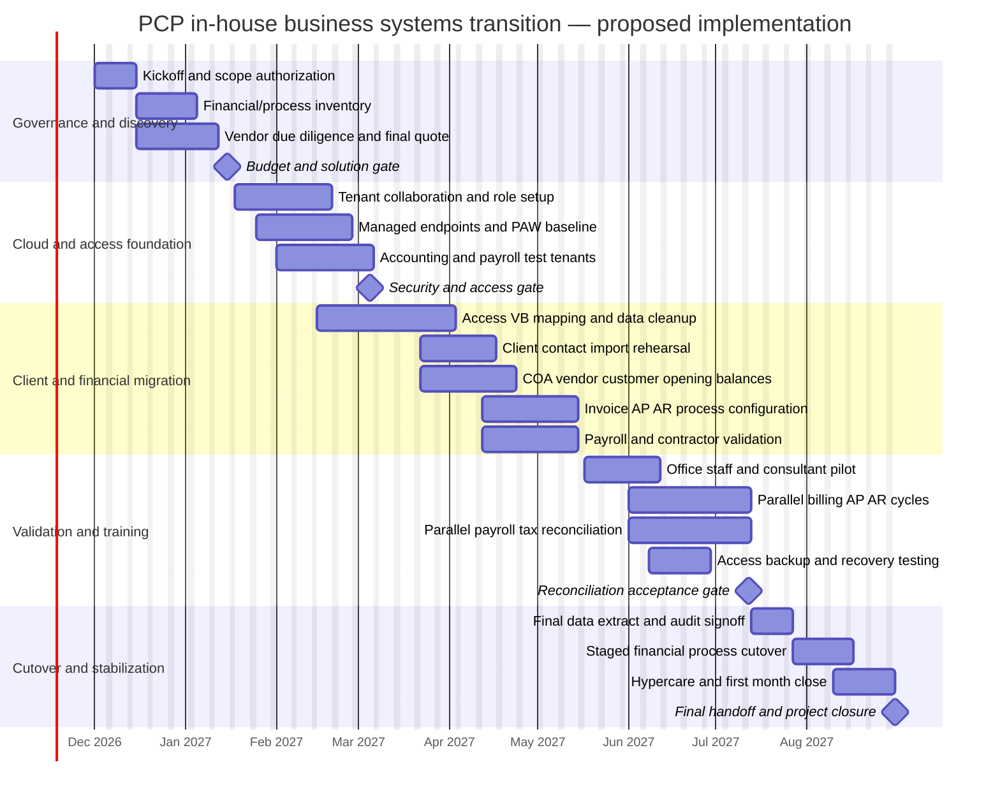

# Implementation Gantt and Dependency Register
**PCP Project 3 | Planned real-world rollout — not academic work already performed**

The professor requires a Gantt showing **how outsourced payroll, billing, AR/AP, and contracts return to PCP staff**. This is a proposed project implementation from December 2026 through August 2027; it is not the student team's November 2026 development schedule.

## Figure 4. Proposed eight-month implementation Gantt
Render this Mermaid source with a compatible diagram tool (GitHub Markdown supports Mermaid) and export the rendered chart as an image for Word/PowerPoint or recreate it in Excel / MS Project. **A code block by itself is not the requested finished Gantt image.**

*Gantt dates are planning assumptions, not contractor commitments or approved delivery dates. Actual calendars and holidays affect effort. Bars are illustrative activities; the milestone gates govern progression and may cause dates to change.*

## Critical dependency and handoff register
| ID | Activities / deliverable | Predecessor / entry condition | Target finish | Acceptance owner |
| --- | --- | --- | --- | --- |
| G1 | Confirm functional scope, responsibility and inventory | Executive kickoff | Dec 2026 | PCP founders |
| G2 | Confirm old provider obligations, exports and pricing | G1, access to Consolidated Business Services records | Jan 2027 | Office process owner |
| G3 | Select accounting/payroll product and approve budget | G2, demos, price/license validation | Jan 15 2027 | Founders / procurement |
| F1 | Establish identity, devices, SharePoint and collaboration | G3, tenant licenses | Feb 2027 | IT / security owner |
| F2 | Provision dedicated privileged endpoints and PIM roles | F1, PAWs and eligibility licensing | Mar 2027 | IT / security owner |
| D1 | Map and clean Access/VB client data | G2, data-owner classification, approved schema | Apr 2027 | Client-data owner |
| D2 | Configure chart of accounts, vendors, customer masters, payroll | G3, validated reference data and jurisdictions | May 2027 | Office/finance owner |
| D3 | Configure AR/AP, billing, controls, contract references | D2, approvals and banking setup | May 2027 | Office process owner |
| T1 | Pilot limited business users and validate security roles | F2, D1–D3 | Jun 2027 | Project lead |
| T2 | Parallel accounting and payroll reconciliations | T1, reliable historical balances and registers | Jul 2027 | Finance/payroll approver |
| C1 | Sign cutover gate (balances, tax, training, restore readiness) | T2; unresolved exceptions cleared | Jul 12 2027 | PCP founders |
| C2 | Staged operational cutover and rollback readiness | C1, service-provider transition consent | Aug 2027 | Business owner |
| C3 | Hypercare, first monthly close and formal handoff | C2, stable first cycles | Aug 31 2027 | Operations owner |

## Milestone gates and stop/go logic
**Gate 1 — Solution authorization:** Appropriate accounting/payroll product chosen; US vs international payroll scope confirmed; actual vendor quotes and staffing capacity approved.

**Gate 2 — Identity and data readiness:** Entra roles and PAW/PIM approach tested as appropriate; protected storage access verified; accounting master data imported into test tenancy; no public access to finance data.

**Gate 3 — Financial control acceptance:** Representative trial invoices, AP entries, AR collection tracking, payroll results and opening-balance totals match verified baseline within documented materiality thresholds. Exceptions require named owner and resolution. Payroll setup and tax obligations confirmed with qualified review.

**Gate 4 — Closure:** First live billing/payroll cycles and reconciliation reviewed; records and support procedures transferred; outside vendor termination complies with contract and retention obligations.

## Staffing and responsibility
- **Founders / executive sponsor:** budget, delegated approvals, service-provider transition authorization, final go-live decision.
- **Office process owner:** manage daily operations and work instructions; approve master data.
- **Office staff / finance operator:** invoices, bills, payment preparation, payroll input and month-end reconciliation subject to segregation-of-duties controls.
- **Independent approver / outsourced professional retained as needed:** review high-impact payments, payroll tax/compliance concerns and first reconciliations.
- **IT / security lead:** identity, endpoint, access controls, migration controls, backups, audit events and security testing.
- **Vendor implementation/support contact:** product configuration and troubleshooting without transferring PCP's final approval authority.

## Academic project delivery checkpoint (separate from company rollout)
| Date range | Student-group activity |
| --- | --- |
| Nov 2–6, 2026 | Website, employee demo, architecture, documentation, DFD groundwork |
| Nov 6–13 | Confirm off-the-shelf finance/payroll product, list prices, assumptions and owner |
| Nov 13–18 | Complete migration narrative, business workflow responsibility matrix, draft Gantt |
| Nov 18–23 | Integrate report narrative, source citations, diagram exports and screenshots |
| Nov 23–25 | Group functional and requirements QA, cross-section consistency check |
| Nov 26–29 | Revise and package after reviewer comments |
| Nov 30 | Submit academic deliverable |

**Critical distinction:** Neither the proposed company go-live nor any cloud implementation has been carried out by the student group. The functional website is a synthetic-data academic demonstration.
