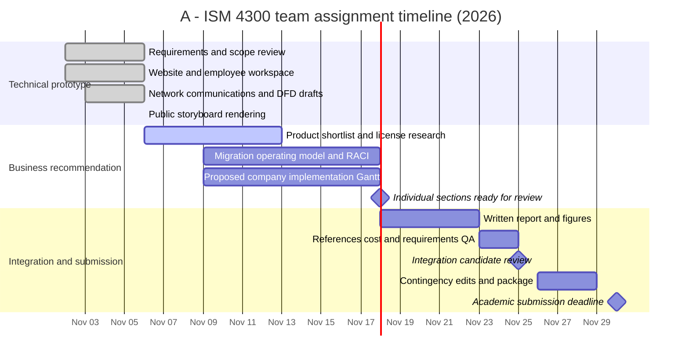
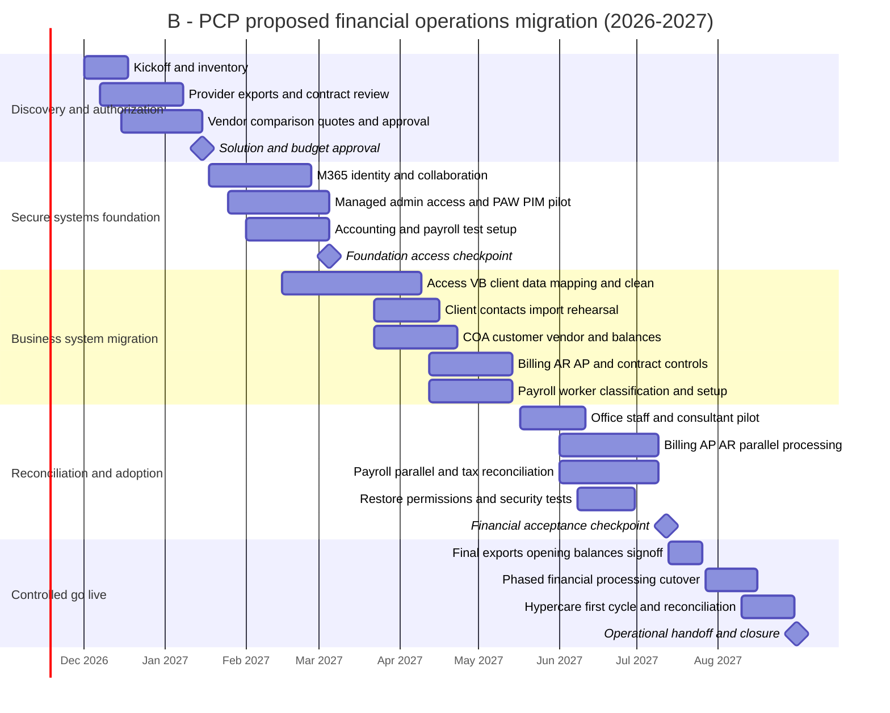
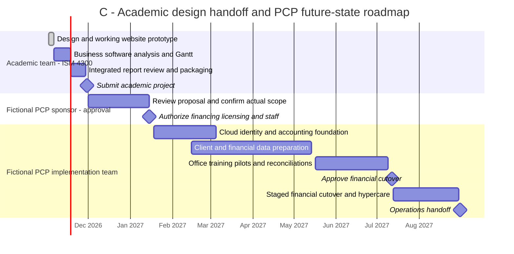

# Three-Gantt Project Plan and Dependency Register
**PCP Project 3 | Academic delivery and hypothetical company implementation | Updated November 6, 2026**

There are **two separate projects** in this case: (1) the student group's assignment, due **November 30, 2026**, and (2) a **fictional PCP production rollout** planned for **December 2026–August 2027**. The third diagram is an integrated roadmap showing their relationship, not a claim that the class group will perform the real migration. All dates outside the assignment deadline are **proposed planning assumptions**.

**Use in final submission:** The professor specifically requires a Gantt for moving payroll, billing, accounts payable/receivable and related functions in-house. **Gantt B is the required implementation view.** Gantt A strengthens evidence of academic project coordination, and Gantt C illustrates the staged handoff from design proposal to hypothetical execution. Render each Mermaid diagram in GitHub or another Mermaid-capable tool and export it as an image for the report; raw Markdown source is not a finished figure. Calendars are inclusive ranges and deliberately do **not** exclude weekends, so checkpoint dates do not silently drift.

## Gantt A — Academic assignment delivery, November 2–30, 2026

**Status and ownership note:** `done` records the technical components already committed to GitHub; it does not certify that the group has accepted every component or that the final submission exists. `active` indicates work underway in the contingency materials, not confirmed progress by other students. Other tasks are proposed checkpoints whose ownership and actual progress require group confirmation. In this diagram, the November 6 storyboard corresponds to the published visual storyboard, not only the original Markdown diagram.

## Gantt B — Fictional PCP implementation, December 2026–August 2027

**This is the assignment-required company migration chart.** It specifically covers the transition from Consolidated Business Services to PCP-managed accounting, billing, AP/AR, contract administration and payroll control. Cloud vendors can still host accounting/payroll software and perform authorized tax/payment processing; “in-house” means PCP staff assume responsibility for governance, approvals, reconciliation and daily operation.

**Conditional activities:** PAWs and PIM require actual license and device procurement; Azure Bastion would be scoped **only if** PCP chooses private Azure VM workloads. No Bastion purchase or private VM deployment is asserted by this timeline. Financial gates can postpone cutover if exports, reconciliation, tax classification, or access testing fail.

## Gantt C — Integrated academic-to-implementation roadmap, November 2026–August 2027

This is a **portfolio-level roadmap**. Its swimlanes represent separate owners and approval authorities. The student team's deliverable ends November 30; a fictional PCP sponsor must separately authorize the production project. **The academic milestone is not permission to deploy, purchase software, or migrate real data.**

### Figure captions for direct report use
- **Figure A — Academic Project Gantt:** Scheduled student-group production, review and submission of the ISM 4300 case deliverables, November 2–30, 2026. Only repository-supported technical activities are marked completed.
- **Figure B — Proposed PCP Implementation Gantt:** Hypothetical migration of outsourced business services to PCP-managed financial operations, December 2026–August 2027; includes authorization, configuration, data preparation, parallel processing and controlled cutover.
- **Figure C — Integrated Roadmap:** Shows the handoff boundary between an academic recommendation and a separate, hypothetical PCP implementation requiring management approval and funding.

### Cross-chart milestone correspondence
| Milestone | Academic Gantt A | PCP Gantt B | Integrated roadmap C |
| --- | --- | --- | --- |
| Group technical design foundation | Nov 2–6 | Not a company implementation task | Academic lane (Nov 2–6) |
| Academic review-ready sections | Nov 18 | N/A | Academic report integration |
| Course submission | Nov 30 | N/A | Explicit academic submission milestone |
| PCP sponsor approval | N/A | Jan 15 | Fictional sponsor authorization milestone |
| Access/financial system baseline | N/A | Mar 5 | Cloud and accounting foundation phase |
| Reconciliation acceptance | N/A | Jul 12 | Proposed cutover approval |
| Final PCP handoff | N/A | Aug 31 | Fictional operations handoff |

---
## Critical dependency and handoff register
| ID | Activities / deliverable | Predecessor / entry condition | Target finish | Acceptance owner |
| --- | --- | --- | --- | --- |
| G1 | Confirm functional scope, responsibility and inventory | Executive kickoff | Dec 2026 | PCP founders |
| G2 | Confirm old provider obligations, exports and pricing | G1, access to Consolidated Business Services records | Jan 2027 | Office process owner |
| G3 | Select accounting/payroll product and approve budget | G2, demos, price/license validation | Jan 15 2027 | Founders / procurement |
| F1 | Establish identity, devices, SharePoint and collaboration | G3, tenant licenses | Feb 2027 | IT / security owner |
| F2 | Provision dedicated privileged endpoints and PIM roles | F1, PAWs and eligibility licensing | Mar 2027 | IT / security owner |
| D1 | Map and clean Access/VB client data | G2, data-owner classification, approved schema | Apr 2027 | Client-data owner |
| D2 | Configure chart of accounts, vendors, customer masters, payroll | G3, validated reference data and jurisdictions | May 2027 | Office/finance owner |
| D3 | Configure AR/AP, billing, controls, contract references | D2, approvals and banking setup | May 2027 | Office process owner |
| T1 | Pilot limited business users and validate security roles | F2, D1–D3 | Jun 2027 | Project lead |
| T2 | Parallel accounting and payroll reconciliations | T1, reliable historical balances and registers | Jul 2027 | Finance/payroll approver |
| C1 | Sign cutover gate (balances, tax, training, restore readiness) | T2; unresolved exceptions cleared | Jul 12 2027 | PCP founders |
| C2 | Staged operational cutover and rollback readiness | C1, service-provider transition consent | Aug 2027 | Business owner |
| C3 | Hypercare, first monthly close and formal handoff | C2, stable first cycles | Aug 31 2027 | Operations owner |

## Milestone gates and stop/go logic
**Gate 1 — Solution authorization:** Appropriate accounting/payroll product chosen; US vs international payroll scope confirmed; actual vendor quotes and staffing capacity approved.

**Gate 2 — Identity and data readiness:** Entra roles and PAW/PIM approach tested as appropriate; protected storage access verified; accounting master data imported into test tenancy; no public access to finance data.

**Gate 3 — Financial control acceptance:** Representative trial invoices, AP entries, AR collection tracking, payroll results and opening-balance totals match verified baseline within documented materiality thresholds. Exceptions require named owner and resolution. Payroll setup and tax obligations confirmed with qualified review.

**Gate 4 — Closure:** First live billing/payroll cycles and reconciliation reviewed; records and support procedures transferred; outside vendor termination complies with contract and retention obligations.

## Staffing and responsibility
- **Founders / executive sponsor:** budget, delegated approvals, service-provider transition authorization, final go-live decision.
- **Office process owner:** manage daily operations and work instructions; approve master data.
- **Office staff / finance operator:** invoices, bills, payment preparation, payroll input and month-end reconciliation subject to segregation-of-duties controls.
- **Independent approver / outsourced professional retained as needed:** review high-impact payments, payroll tax/compliance concerns and first reconciliations.
- **IT / security lead:** identity, endpoint, access controls, migration controls, backups, audit events and security testing.
- **Vendor implementation/support contact:** product configuration and troubleshooting without transferring PCP's final approval authority.

## Academic delivery details
The more detailed student delivery schedule now appears in **Gantt A**, and the relationship to the fictional implementation appears in **Gantt C**. The department's requested migration timeline remains **Gantt B**. Do not interpret proposed student tasks as completed until the actual artifacts and group review support that claim.

**Critical distinction:** Neither the proposed company go-live nor any cloud implementation has been carried out by the student group. The functional website is a synthetic-data academic demonstration.
