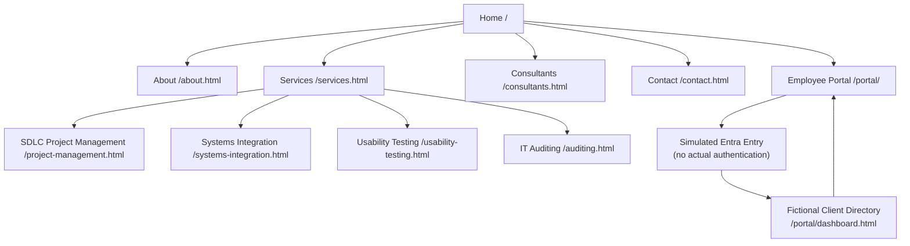
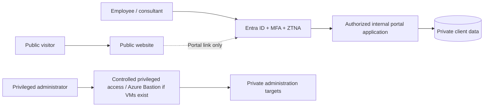

# PCP Website Storyboard and Navigation Plan

**Course:** ISM 4300 — Project 3  
**Project:** Project Consultants Plus (PCP)  
**Document status:** Website design artifact — November 6, 2026  
**Scope:** Public consulting website and academic employee-portal demonstration

## Purpose

This storyboard is the software-created plan for the PCP website. It organizes the page hierarchy, shared visual layout, expected visitor actions, and transitions into the separately styled employee portal. It is intended to support the course website deliverable and the final report. The diagram below renders through GitHub's Mermaid diagramming support.

## Navigation / sitemap



**Navigation behavior:** Shared public-page header includes Home, About, Services (expandable menu with its specialty pages), Consultants, Contact, and Employee Portal. Service cards also open their dedicated detail pages. The public website links only to the portal landing page, not directly to the demonstration directory.

**Security limitation:** The client directory is static and directly addressable by URL. The Entra-style interaction visually represents a future identity flow; it is not an authentication or authorization boundary. No confidential data, real sign-in, or production integration is present.

## Common page layouts — storyboard panels

### Panel A: Homepage

```text
┌──────────────────────────────────────────────────────────────┐
│ PCP logo | Home | About | Services ▾ | Consultants | Contact │
│                                           [Employee Portal]  │
├─────────────────────────────────┬────────────────────────────┤
│ HERO: headline, value           │ Architectural visual      │
│ proposition, summary            │ PLAN / INTEGRATE / DELIVER │
│ [Explore our services]          │                            │
├─────────────────────────────────┴────────────────────────────┤
│ Company purpose and mission                                  │
├──────────────────────────────────────────────────────────────┤
│ Service cards: SDLC | Integration | Usability | Auditing      │
│ Each card links to an individual detail page                 │
├──────────────────────────────────────────────────────────────┤
│ Closing call-to-action and site footer                       │
└──────────────────────────────────────────────────────────────┘
```

**Visitor objective:** Understand what PCP offers and navigate into consulting services or employee access.

### Panel B: About / Services / Specialty / Consultants / Contact

```text
┌──────────────────────────────────────────────────────────────┐
│ Shared public navigation                                     │
├──────────────────────────────────────────────────────────────┤
│ Page title / focused value proposition                       │
├──────────────────────────────────────────────────────────────┤
│ Introductory explanation                                     │
│ ┌─────────────────────────┬────────────────────────────────┐ │
│ │ Focus / capability 01   │ Focus / capability 02          │ │
│ ├─────────────────────────┼────────────────────────────────┤ │
│ │ Focus / capability 03   │ Focus / capability 04          │ │
│ └─────────────────────────┴────────────────────────────────┘ │
├──────────────────────────────────────────────────────────────┤
│ Return to services / next step                               │
├──────────────────────────────────────────────────────────────┤
│ Footer and academic prototype disclosure                     │
└──────────────────────────────────────────────────────────────┘
```

**Page variations:** About includes the case-study founders, mission and company context; Services links to four specialty pages; Consultants highlights PMI certification and the case's 100% service guarantee; Contact explains its proposed privacy-conscious inquiry workflow but does not submit information.

### Panel C: Employee portal landing

```text
┌──────────────────────────────────────────────────────────────┐
│ PCP brand                                        Back to site │
├──────────────────────────────┬───────────────────────────────┤
│ Employee portal explanation  │ Microsoft Entra-style panel   │
│ and proposed security model  │ Label: SIMULATED              │
│                              │ [Continue to staff workspace]│
├──────────────────────────────┴───────────────────────────────┤
│ Explicit notice: no actual sign-in, MFA or authorization     │
└──────────────────────────────────────────────────────────────┘
```

**Action:** The button navigates to the demonstration directory. It does not request or validate credentials.

### Panel D: Employee client directory

```text
┌──────────────────────────────────────────────────────────────┐
│ PCP / STAFF WORKSPACE                           Portal back  │
├──────────────────────────────────────────────────────────────┤
│ FICTIONAL DATA / NOT AUTHENTICATED banner                    │
│ Sample client count / summary metrics                       │
├──────────────────────────────────────────────────────────────┤
│ [Search client, contact, location...]                        │
│ [Filter by service category]                                 │
│ Client result cards with synthetic contact details          │
└──────────────────────────────────────────────────────────────┘
```

**Action:** Users filter and search fictional records in browser JavaScript. No server request, database access, or identity check is performed.

## Page inventory and expected interactions

| Page | Path | Purpose | Interaction |
| --- | --- | --- | --- |
| Home | `/` | Introduce consulting practice | Services CTA and cards |
| About | `/about.html` | History, mission, operating model | Shared navigation |
| Services | `/services.html` | Overview of four offerings | Links to specialty pages |
| SDLC Project Management | `/project-management.html` | SDLC planning through turnover | Return to services |
| Systems Integration | `/systems-integration.html` | Integration design and transition | Return to services |
| Usability Testing | `/usability-testing.html` | User/task/accessibility evaluation | Return to services |
| IT Auditing | `/auditing.html` | Assessment and remediation planning | Return to services |
| Consultants | `/consultants.html` | Professional model and PMI focus | PMI link |
| Contact | `/contact.html` | Privacy-conscious inquiry concept | Informational, no submission |
| Employee Portal | `/portal/` | Employee access landing | Simulated Entra-style continuation |
| Directory demo | `/portal/dashboard.html` | Synthetic client/contact search | Client-side search and filter |

**Page-count interpretation:** Nine public corporate information pages plus one employee portal entry page meets the approximately ten-page target. The directory is an additional supporting prototype view.

## Proposed production separation (not implemented)



The production model requires real identity controls, backend authorization, private storage, telemetry, and operational governance. The public Netlify prototype is not a substitute for those safeguards.

## Storyboard acceptance checklist

- [x] Sitemap identifies the homepage, consulting pages, and portal views.
- [x] All required specialty services have dedicated pages.
- [x] Public and employee-facing routes are distinguished.
- [x] Prototype behavior versus proposed production security is explicitly separated.
- [x] Wireframes specify common content blocks and actions.
- [ ] Verify every public link and keyboard-operated dropdown on the deployed site.
- [ ] Verify responsive layouts at mobile and desktop widths.
- [ ] Capture final screenshots for the submitted project report.

**Source:** ISM 4300 Project 3, Project Consultants Plus case. The specific navigation, layout, and security design are the team's proposed implementation, not features specified by the case.
